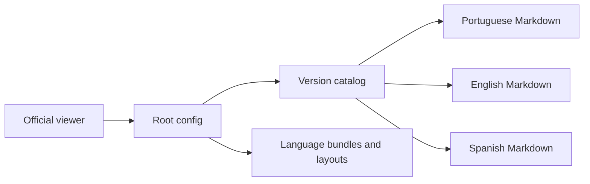

# git-page-docs-example: Project context and workflows

GitPageDocs **0.0.17** · 0.0.17 · 2026-10-29

## Context

GitPageDocs consumer example containing configuration, icon, translations and versioned Markdown. It is not the CLI/viewer source. It has no backend, database, application authentication or application package.json. Current content uses contract 0.0.17; 0.0.8 remains in the catalog as history.

## Stack and architecture

gitpagedocs/config.json defines identity, languages, theme, rendering and VersionControl. Each version points to its config.json; routes-md/menus-header-md point to language-specific files. langs contains UI labels. Official layouts are pinned to v0.0.17. An external viewer loads the contract; this repository does not need React/Next installed for content editing.

## End-to-end workflows

1. Reader opens the official viewer and selects Vidigal-code/git-page-docs-example → viewer reads root config → selects version/language → loads catalog → resolves Markdown → renders menus, outline and navigation. rendering points to the official viewer; ProjectLink/source-viewer point to this example.

2. Editor changes Markdown in three languages → registers a route with a unique ID/existing path → updates menus without breaking IDs → validates JSON/links → reviews the diff. For a new version create folder/config and register a real VersionControl entry while preserving history. CLI version and consumer application version are independent concepts.

3. Version 0.0.17 supports named branch/release/commit arrays of {name,url}. Link only existing resources. This example links a real branch/commit without inventing a release. Do not run the generic scaffold over reviewed content without comparing changes; its product demonstration pages do not automatically describe this repository.

## Data, security and limitations

Markdown/JSON in a public repository are public. Viewer auth.accessKeys/docsAccess do not make public files private; actual confidentiality requires source access controls. Do not store tokens in config, examples or URLs. Keep text alternatives, heading hierarchy and clear menu labels for accessibility.

## Setup, testing and operations

Edit gitpagedocs only. This repository has no documentation deployment workflow. Updating it does not publish to GitHub Pages or run --push/deploy. Check the CLI with the pinned version command in the internal README. For 404 check VersionControl, route paths, language and files. Wrong identity: ProjectLink/source-viewer; wrong theme: official URLs. The root README describes the historical 0.0.8 baseline and remains outside this folder-only change.

## Complete reference

Dependencies, commands, endpoints, variables, contracts and tests are in the [source reference](?menu=en&lang=en&id=14).

## Verifiable sources

- [README.md](https://github.com/Vidigal-code/git-page-docs-example/blob/b5b8ad11d28dbbcd904b105d625c72efd2805cd5/README.md)
