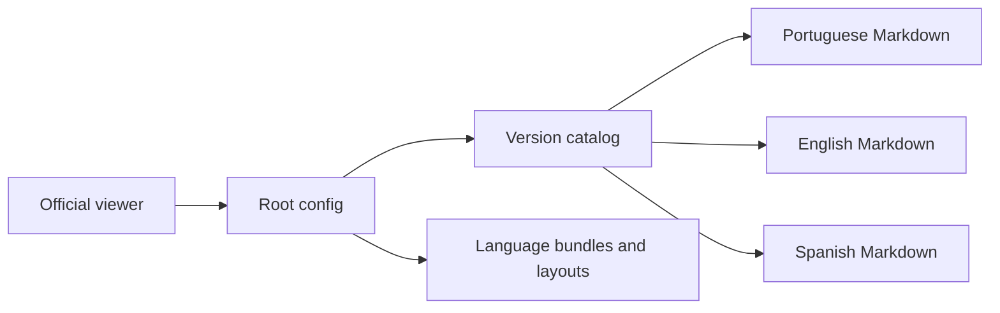

# git-page-docs-example: Contexto y flujos del proyecto

GitPageDocs **0.0.17** · 0.0.17 · 2026-10-29

## Contexto

Ejemplo consumidor de GitPageDocs con configuración, icono, traducciones y Markdown versionado. No es código fuente del CLI/visor. No tiene backend, banco, autenticación de aplicación ni package.json de aplicación. Contenido actual usa contrato 0.0.17; 0.0.8 permanece como histórico.

## Stack y arquitectura

gitpagedocs/config.json define identidad, idiomas, tema, rendering y VersionControl. Cada versión apunta a su config.json; routes-md/menus-header-md apuntan a archivos por idioma. langs contiene etiquetas UI. Layouts oficiales están fijados en v0.0.17. Un visor externo carga el contrato; editar contenido no requiere instalar React/Next.

## Flujos completos

1. Lector abre visor oficial y selecciona Vidigal-code/git-page-docs-example → lee config raíz → elige versión/idioma → carga catálogo → resuelve Markdown → presenta menús/índice/navegación. rendering apunta al visor oficial; ProjectLink/source-viewer a este ejemplo.

2. Editor modifica Markdown en tres idiomas → registra route con ID único/path existente → actualiza menús sin romper IDs → valida JSON/enlaces → revisa diff. Para nueva versión cree carpeta/config y entrada real en VersionControl preservando historia. Versión CLI y versión de aplicación consumidora son conceptos independientes.

3. 0.0.17 admite arrays branch/release/commit de {name,url}. Enlace solo recursos existentes. Este ejemplo usa branch/commit reales sin inventar release. No ejecute scaffold genérico sobre contenido revisado sin comparar; sus demostraciones no describen automáticamente este repositorio.

## Datos, seguridad y límites

Markdown/JSON públicos siguen públicos. auth.accessKeys/docsAccess del visor no privatizan archivos públicos; confidencialidad requiere controlar origen. No almacene tokens en config/ejemplos/URLs. Mantenga alternativas textuales, jerarquía de títulos y menús claros para accesibilidad.

## Ejecución, pruebas y operación

Edite solo gitpagedocs. No existe workflow de despliegue documental aquí. Actualizar no publica en GitHub Pages ni ejecuta --push/deploy. Compruebe CLI con comando fijado en README interno. Ante 404 revise VersionControl, paths, idioma y archivos. Identidad incorrecta: ProjectLink/source-viewer; tema: URLs oficiales. README raíz describe base histórica 0.0.8 y queda fuera de este cambio limitado.

## Referencia completa

Dependencias, comandos, endpoints, variables, contratos y pruebas están en la [referencia del código](?menu=es&lang=es&id=14).

## Fuentes verificables

- [README.md](https://github.com/Vidigal-code/git-page-docs-example/blob/b5b8ad11d28dbbcd904b105d625c72efd2805cd5/README.md)
