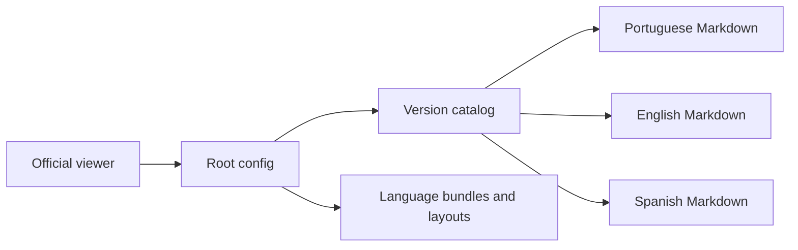

# Visão geral do projeto

Exemplo de consumo do GitPageDocs, formado por configuração, ícone, traduções e Markdown versionado. Não é o código-fonte do CLI nem do viewer. Não possui backend, banco, autenticação de aplicação ou package.json de aplicação. O conteúdo atual usa o contrato 0.0.17; 0.0.8 permanece no catálogo como histórico.

## Comportamento implementado

gitpagedocs/config.json define identidade, idiomas, tema, rendering e VersionControl. Cada versão aponta para seu config.json; routes-md e menus-header-md apontam para arquivos por idioma. langs contém textos da interface. Layouts oficiais estão fixados em v0.0.17. O viewer é externo e carrega esse contrato; o repositório não precisa instalar React/Next para editar conteúdo.



## Fluxo e casos de falha

1. Leitor abre o viewer oficial e seleciona Vidigal-code/git-page-docs-example → viewer lê a configuração raiz → escolhe versão/idioma → carrega catálogo → resolve Markdown → apresenta menus, índice e navegação. A URL rendering aponta para o viewer oficial; ProjectLink/source-viewer apontam para este exemplo.

2. Editor altera Markdown nas três línguas → registra route com ID único e path existente → atualiza menus sem quebrar IDs → valida JSON/links → revisa diff. Para nova versão, crie pasta/config e acrescente entrada real em VersionControl, preservando histórico. A versão do CLI e a versão de uma aplicação consumidora são conceitos independentes.

3. A versão 0.0.17 aceita links nomeados de branch/release/commit em arrays de {name,url}. Use somente recursos que existem. O exemplo vincula branch e commit reais, sem inventar release. Não execute o scaffold genérico sobre conteúdo revisado sem comparar alterações; ele inclui páginas de demonstração do produto que não descrevem automaticamente este repositório.

## Configuração e implantação

Edite somente gitpagedocs. Não existe workflow de deploy de documentação neste repositório. A atualização não publica no GitHub Pages nem executa --push/deploy. Para conferir CLI, use o comando de versão fixado no README interno. Para 404 confira VersionControl, paths de rotas, idioma e existência dos arquivos. Para identidade errada confira ProjectLink e source-viewer; para tema confira URLs oficiais. O README da raiz descreve a base histórica 0.0.8 e permanece fora do escopo desta alteração restrita.

## Comandos de execução

```sh
npx --yes --package @gitpagedocs/cli@0.0.17 gitpagedocs version
```

## Arquivos relacionados

- [README.md](https://github.com/Vidigal-code/git-page-docs-example/blob/b5b8ad11d28dbbcd904b105d625c72efd2805cd5/README.md)

## Navegação

- [Project guide](?menu=pt&lang=pt&id=13)
- [Source reference](?menu=pt&lang=pt&id=14)
